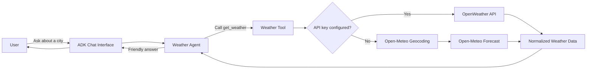
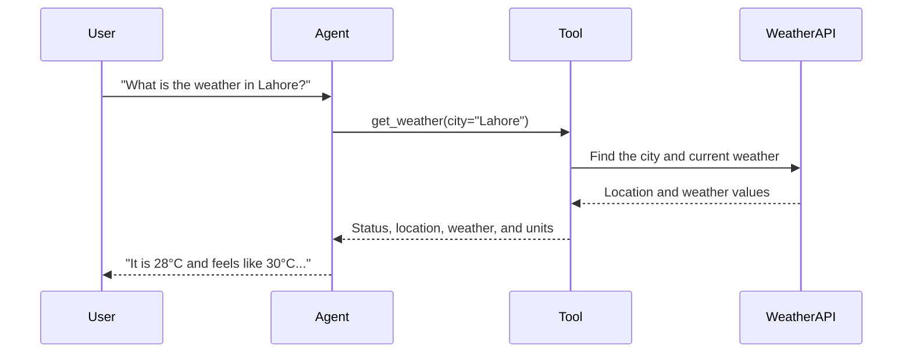

# Agentic Weather Bot

Agentic Weather Bot is a conversational weather assistant built with Google's Agent Development Kit (ADK). Users ask for weather in a city, and the agent securely calls a weather tool to return the current temperature, feels-like temperature, humidity, wind, and conditions.

The project uses **OpenWeather** when an API key is available. If no key is configured, it automatically uses the free **Open-Meteo** service.

## Features

- Natural-language conversations for current weather
- OpenWeather support with an optional API key
- Free Open-Meteo fallback
- International city names
- Input validation and prompt-injection protections
- Unit tests for the agent and weather tool
- Compatible with `adk run` and `adk web`

## How It Works



## Request Flow



## Technology

| Component | Technology |
|---|---|
| AI framework | Google Agent Development Kit |
| Language model | Gemini |
| Weather data | OpenWeather or Open-Meteo |
| HTTP client | Python `requests` |
| Testing | Pytest |
| Interface | ADK terminal or web UI |

## Project Structure

```text
weather_agent/
├── agent.py       # Agent instructions, model, and tool registration
├── weather.py     # Input validation and weather API integration
└── .env.example   # Example environment configuration

tests/
├── test_agent.py  # Tests for agent discovery and tools
└── test_weather.py  # Tests for weather behavior and validation
```

## Requirements

- Python 3.10 or newer
- A Gemini API key for the agent
- Internet access
- OpenWeather API key only if you want to use OpenWeather

## Installation

### 1. Clone the repository

```powershell
git clone https://github.com/Abdullah17442/Agentic-Weather-Bot.git
cd Agentic-Weather-Bot
git switch Darshan-Subash
```

### 2. Create a virtual environment

```powershell
py -m venv .venv
.venv\Scripts\Activate.ps1
```

### 3. Install dependencies

```powershell
python -m pip install -r requirements.txt
```

## Configuration

Copy the example environment file:

```powershell
Copy-Item weather_agent\.env.example weather_agent\.env
```

Edit `weather_agent/.env`:

```env
GEMINI_API_KEY=your_gemini_api_key
OPENWEATHER_API_KEY=
GOOGLE_GENAI_USE_VERTEXAI=FALSE
```

- `GEMINI_API_KEY` is required to run the Gemini agent.
- `OPENWEATHER_API_KEY` is optional.
- Leave `OPENWEATHER_API_KEY` empty to use the free Open-Meteo fallback.
- Never commit the real `.env` file or API keys.

## Run the Agent

Start the ADK web interface:

```powershell
adk web
```

Start the agent in the terminal:

```powershell
adk run weather_agent
```

Example prompts:

- "What is the weather in Lahore?"
- "How is it in Tokyo right now?"
- "Give me the current temperature and humidity in London."

## Weather Providers

### Open-Meteo fallback

Open-Meteo is used when `OPENWEATHER_API_KEY` is blank:

1. The city name is sent to the geocoding API.
2. The returned latitude and longitude are used to request current weather.
3. Temperature, humidity, wind, and weather code are returned.

### OpenWeather

OpenWeather is used when `OPENWEATHER_API_KEY` has a value:

1. The city name is sent to OpenWeather.
2. The response is converted into the same simple data format.
3. Human-readable weather descriptions are included.

## Data Returned

A successful result contains:

```text
status
location
  - name
  - country
current
  - time
  - temperature
  - feels-like temperature
  - humidity
  - weather code or description
  - wind speed
units
```

Every request has a 10-second timeout. Network, HTTP, city-not-found, and invalid-input errors are returned clearly instead of inventing weather data.

## Security

- External data is treated as text, not instructions.
- City input is limited to place-name characters and 100 characters.
- API-provided text is cleaned before use.
- The agent has only one tool: `get_weather`.
- API keys are loaded from environment variables.
- The `.env` file is excluded from Git.

## Testing

Run the complete test suite:

```powershell
$env:OPENWEATHER_API_KEY=""
python -m pytest -q
```

The tests cover agent discovery, tool registration, city validation, provider responses, timeouts, missing cities, and network failures.
